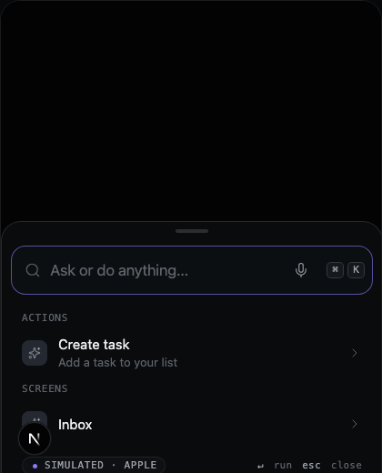

<p align="center">
  
</p>

<p align="center"><strong>AI that lives on the phone.</strong><br/>Beautiful on-device AI components for React Native. Copy. Paste. Private AI.</p>

<p align="center">
  <a href="#"></a>
  <a href="#"></a>
  <a href="#"></a>
</p>

<p align="center"></p>

Ondai is **shadcn/ui for on-device AI in React Native**: a registry of copy-paste components, each a complete AI feature powered by the model already on the user's phone (Apple Foundation Models on iOS 26, Gemini Nano on Android, llama.rn as an opt-in fallback). Free: no API bill. Private: nothing leaves the device. Offline. Fast.

## Quickstart

```bash
npx ondai init            # installs @ondai/core, @ondai/tokens, ai v6, the Callstack providers; writes ondai.json
npx ondai add command-bar # copies the component (and its registry dependencies) into components/ondai/
```

```tsx
import { CommandBar, defineActions, defineAction } from '@/components/ondai/command-bar'

const actions = defineActions([
  defineAction({ id: 'task.create', title: 'Create task', params: z.object({ title: z.string() }), run: (p) => tasks.add(p) }),
])

<CommandBar actions={actions} presentation="spotlight" variant="glass" />
```

Wrap the app in `<OndaiProvider>` (generated by `init`), import the polyfills first, rebuild the dev client. Full steps: [docs/installation](apps/web/content/docs/installation.mdx).

## Components

| | Component | What it does | Presentations |
| --- | --- | --- | --- |
| ⭐ | **CommandBar** | Natural language → one of your registered actions, chosen on device (tool calling → structured → keyword) | spotlight · sheet · inline · pill · fullscreen |
| ⭐ | **SmartInput** | Text, voice or photo fills your zod form, per-field confidence, confirm/undo | field · composer · overlay · card |
| ⭐ | **ScanToData** | Camera or photo → OCR → receipt / business card / event / your schema | camera · picker · card |
| ⭐ | **Summarize** | Streaming TL;DR, map-reduce for long text | card · inline · sheet · tooltip |
| ⭐ | **Rewrite** | Shorten, expand, friendlier, formal, fix grammar | toolbar · menu · chips (replace · diff · side by side) |
| ⭐ | **SmartReply** | Three reply suggestions | chips · stack · ghost |
| ⭐ | **AutoTag** | Tags from your own list, fuzzy-matched | chips · inlineGhost · dropdown |
| ⭐ | **SemanticSearch** | Search by meaning with a local vector index + keywords | bar · spotlight · header |
| ⭐ | **NaturalFilter** | "cheap Italian open now" → typed filter chips | bar · sheet · inline |
| ⭐ | **ToolConfirmCard** | Approval for any tool call with risk level | card · sheet · banner |
| | Primitives | AvailabilityGate, OnDeviceBadge, IonBorder, StreamingText, ThinkingIndicator, Skeleton, KeyHint, LatencyChip, ModelDownload, Chip, Button, Sheet, Field | |

Every component ships a styled component, a headless hook, variants, prompts, a zod schema, a playground definition (controls + mock scripts per state), a README, a test and, where it talks to the model, eval fixtures. Contact sheets of every state in Void and Paper: [docs/design-review](docs/design-review).

## Runs on

| Platform | Model | Status |
| --- | --- | --- |
| iPhone 15 Pro+, iPad M1+, Apple silicon Macs (iOS/macOS 26, Apple Intelligence on) | Apple Foundation Models via `@react-native-ai/apple` | supported (~360 ms to first token, ~86 tok/s on Apple silicon) |
| Android 14+ with AICore (Pixel 9+, Galaxy S26, …) | Gemini Nano via `@react-native-ai/adk` | supported |
| Any phone | GGUF via `@react-native-ai/llama` (opt-in download) | adapter implemented · not installed in the gallery (llama.rn version mismatch) |
| Web / tests | Scripted mock (a real AI SDK model) | the playground, Storybook-style stories and all tests |

Details and caveats: [docs/ECOSYSTEM.md](docs/ECOSYSTEM.md).

## Built on

[Callstack react-native-ai](https://github.com/callstackincubator/ai) · [Vercel AI SDK](https://ai-sdk.dev) · [Expo](https://expo.dev) · [Reanimated](https://docs.swmansion.com/react-native-reanimated/). When their engines improve, Ondai improves.

## Run it locally

```bash
pnpm install && pnpm dev     # website + playground at http://localhost:3000 (no device needed)
pnpm dev:gallery             # Expo gallery (iOS 26 simulator / device)
pnpm test && pnpm test:visual
```

- `/playground`: every component, variant, prop and state with live controls and URL state.
- `/review`: everything in Void and Paper on one page.
- `/themes`: theme and accent builder with token export.

See [docs/RUNNING.md](docs/RUNNING.md), [docs/ARCHITECTURE.md](docs/ARCHITECTURE.md), [docs/DESIGN.md](docs/DESIGN.md).

## Roadmap

P1: AgentSheet, ActionSuggestions, HowDoI, NaturalDateInput, GhostText, SmartPaste, VoiceToForm, Proofread, ExplainThis, KeyPoints, TaskExtractor, EventExtractor, AskYourData, RedactPII, VoiceCommand, CleanDictation, DigestCard; the `expo-ai` provider when it ships; Android Nano validation on hardware. See the full plan in the repository history.

## License

MIT
